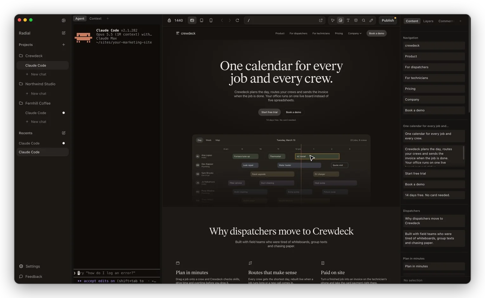

# Radial for Mac

The open-source editor for marketing sites. Run Claude Code, Codex or Cursor beside a live preview of your site, edit the page directly, and publish to GitHub.



This repository is Radial for Mac, the editor that runs on your Mac. It's free and open source under the Apache License 2.0. Radial Cloud, the hosted product for teams, is a separate service and isn't part of this repository.

## Download

Get the official app at [radial.to/download](https://radial.to/download). It's signed, it updates itself, and it's the quickest way to start.

## What you need

- A Mac with Apple silicon.
- An agent you're signed in to on the command line: Claude Code, Codex or Cursor.
- A site to work on, from a folder on your Mac or a GitHub repository.

## Build from source

You need Node 20 or newer and the Xcode command line tools (`xcode-select --install`).

```sh
git clone https://github.com/Radial-to/radial.git
cd radial
npm ci
npm start
```

`npm start` runs the app straight from the source. Run the tests with `npm test`.

To make an app you can open from Finder:

```sh
npm run pack    # an unsigned app in dist/mac-arm64
npm run dist    # an unsigned .dmg and .zip in dist
```

If `npm ci` fails while it builds native modules, point it at the system Python: `PYTHON=/usr/bin/python3 npm ci`.

### How builds from source differ

Apps you build yourself are called Radial Dev and have a plain icon, so they're easy to tell apart from the official app, and they keep their own settings. They don't update themselves and they don't send usage data.

## Run Radial without a window

Radial also runs without its window, as `radial serve`, so a coding agent in a VM, a container or a Linux server can use it: open a site and run its dev server, change text and images, take screenshots, leave comments, publish, and start agent sessions. It's the same Radial as the Mac app, from the same code, and it runs on Linux and macOS.

If you have Radial for Mac, you don't need this: the app's own `radial` command does the same with the app.

### Install

You need Node 22.18 or newer and git. Your sites need Node for their dev servers anyway.

```sh
npm install -g radial-cli
radial setup
```

`radial setup` starts `radial serve` in the background, adds Radial's MCP server to Claude Code and Codex when they're installed, and ends with `radial doctor`, which lists what else this machine needs and what to run for each. Running it again changes nothing that's already set up.

Agent sessions run in terminals that need node-pty, a native module. The package carries ready-made builds of it for macOS, and for Linux on x64 and arm64. Anywhere else, Alpine included, it's built on install, which needs python3, make and g++ (`sudo apt-get install -y python3 make g++` on Debian and Ubuntu). npm 12 runs a package's install steps only when you allow them, so there install it with `npm install -g radial-cli --allow-scripts=radial-cli`. With the ready-made builds that step has nothing to do, so npm 12's note that it blocked it is fine to ignore. `radial doctor` says whether node-pty works, and what to run when it doesn't.

To install without root, give npm a folder of your own for global packages first: `npm config set prefix ~/.npm-global`, then add `~/.npm-global/bin` to your PATH.

Screenshots, page fields and migration compares need a browser. `radial browser install` downloads Chrome Headless Shell. On Linux it also needs some system libraries: as root it installs them, and otherwise it prints the line to run.

### Docker

Build the images from a checkout of this repository:

```sh
npm ci
npm run pack:cli
docker build -f docker/Dockerfile -t radial dist/cli
docker build -f docker/Dockerfile --target browser -t radial-browser dist/cli
```

Then run one and make a token for it:

```sh
docker run -d --name radial -p 4000-4020:4000-4020 -v radial-data:/data -v "$PWD":/work radial
docker exec radial radial token create laptop
```

The container runs `radial serve --listen 0.0.0.0:4000 --allow-remote` as the `node` user (uid 1000), with tini as its init process. Port 4000 takes MCP, the CLI and events, and each open project's preview gets a port of its own from 4001 up, so publish the range one to one. `/data` keeps Radial's state, its tokens included, and `/work` holds your sites. On Linux, the folder you mount at `/work` has to be writable by uid 1000. Until you make a token, the container refuses every request.

The `browser` image adds Chrome Headless Shell. Docker's default security settings leave Chrome no room for its sandbox, so it runs without it there.

### Reach it from another machine

`radial serve --listen 127.0.0.1:4000` takes HTTP beside the local socket: MCP at `/mcp`, the CLI at `/rpc` and events at `/events`. Every request needs a token. `radial token create <name>` makes one and shows it once.

On the other machine:

```sh
export RADIAL_URL=http://<the machine>:4000
export RADIAL_TOKEN=<the token>
radial ls
claude mcp add --transport http radial "$RADIAL_URL/mcp" --header "Authorization: Bearer $RADIAL_TOKEN"
```

`radial setup --listen 127.0.0.1:4000` does all of this in one go and prints those lines with the token in them.

Radial listens only on the machine's own address unless you pass `--allow-remote`. Rather than open it to a network, put SSH (`ssh -L 4000:127.0.0.1:4000 <the machine>`) or Tailscale in front: a token lets whoever holds it do anything Radial can, agent sessions included. `radial url` prints a project's preview address, and `radial url --share` makes a link a browser on another machine can open.

### Agents that run unattended

Agent sessions use whatever their CLI is signed in to on that machine, so run `claude` or `codex` once and sign in. For agents that run unattended, a fleet of VMs for one, use an API key: set `ANTHROPIC_API_KEY` for Claude Code in the environment `radial serve` starts from (its agent sessions get the same environment), and sign Codex in with `codex login --with-api-key`. `radial doctor` says whether each CLI is installed and signed in, without showing any key.

## Usage data

The official app sends anonymous usage events and error reports, so we can see what to fix and improve. They never include your site's content. You can turn them off in Settings. Builds from source send nothing.

The `radial-cli` package from npm sends anonymous usage events: which commands and features ran, and errors in Radial's own code (what kind, and where in its code), with the app version and OS. They never include content: no files, page text, prompts, paths, addresses or tokens. The first `radial serve` says so once.

Turn them off with `radial telemetry off`, or set `DO_NOT_TRACK=1`. They're also off whenever `CI` is set. `radial telemetry status` shows whether they're on, and where the local log of every event sent is. The list of events is at [radial.to/docs/usage-data](https://radial.to/docs/usage-data). Copies built from source send nothing.

## Issues

Found a bug or have an idea? [Open an issue](https://github.com/Radial-to/radial/issues/new/choose). For now we're not taking pull requests: describe the problem or the idea in an issue instead. [CONTRIBUTING.md](CONTRIBUTING.md) has the details.

Please don't report security problems in public issues. See [SECURITY.md](SECURITY.md).

## License

Radial for Mac is open source under the [Apache License 2.0](LICENSE). You can use, change and share the code, including in commercial work.

The Radial name, logo and app icon aren't covered by the license. If you share your own version of the app, give it your own name and icon. See [TRADEMARKS.md](TRADEMARKS.md).

Code and fonts from other projects keep their own licenses, listed in [THIRD_PARTY_NOTICES.md](THIRD_PARTY_NOTICES.md).
